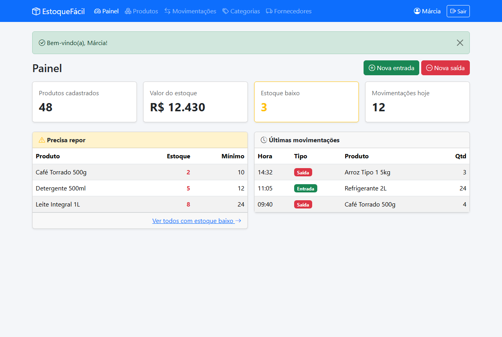
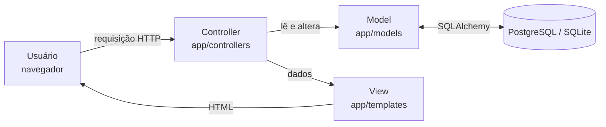

# EstoqueFácil: Controle de Estoque para Pequenos Comércios

**Projeto Integrador Transdisciplinar em Engenharia de Software II**

> 🚧 **Em desenvolvimento**

**Autor:** [@Carlosvpontes](https://github.com/Carlosvpontes)

## Sobre o projeto

Pequenos comércios costumam controlar o estoque em cadernos ou planilhas, o que causa falta de
produtos, compras desnecessárias e nenhum histórico de quem retirou ou repôs mercadoria.

O **EstoqueFácil** é um sistema web simples para o comerciante saber, a qualquer momento,
**o que tem, quanto tem e o que precisa repor**:

- Cadastro de produtos, categorias e fornecedores;
- Registro de entradas e saídas de mercadoria, com data, hora e responsável;
- Bloqueio de saídas maiores que o estoque disponível;
- Alerta automático de produtos com estoque baixo;
- Painel com a situação geral do estoque.



📄 Documentação completa do planejamento: [docs/situacao-1](docs/situacao-1/README.md)

## Links

| Item | Link |
|---|---|
| Sistema em funcionamento | _a definir_ |
| Vídeo de demonstração (narrado) | _a definir_ |
| Vídeo da solução atualizada | _a definir_ |

## Tecnologias

| Camada | Tecnologia |
|---|---|
| Back-end | Python 3 + Flask (arquitetura MVC) |
| Front-end | HTML5, CSS3 (Bootstrap), JavaScript |
| Banco de dados | PostgreSQL no [Neon](https://neon.tech) (produção) / SQLite (desenvolvimento local) |
| Testes | pytest |
| Hospedagem | [Render](https://render.com) (plano gratuito) — ver [guia de publicação](docs/situacao-2/publicacao-render-neon.md) |
| Modo de codificação | Tradicional |

## Como executar no seu computador (Windows)

Pré-requisito: [Python 3.11+](https://www.python.org/downloads/).

| Ação | Como fazer |
|---|---|
| Abrir o sistema | Duplo clique em **`rodar_local.bat`**. O navegador abre em http://127.0.0.1:5000 |
| Login de exemplo | `demo@estoquefacil.com` / senha `demo123` |
| Rodar os testes | Duplo clique em **`rodar_testes.bat`** |
| Recomeçar o banco do zero | `.venv\Scripts\python.exe criar_banco.py --recriar --exemplo` |

Na primeira execução, o script cria o ambiente Python (`.venv`), instala as bibliotecas e cria
um banco SQLite com dados de exemplo em `instance/estoque.db`.

## Arquitetura (MVC)



| Camada | Pasta | Responsabilidade |
|---|---|---|
| **Model** | `app/models/` | Tabelas do banco e regras de negócio (ex.: bloquear saída maior que o estoque) |
| **View** | `app/templates/`, `app/static/` | Telas HTML (Bootstrap), CSS e JavaScript |
| **Controller** | `app/controllers/` | Recebe as ações do usuário, chama o Model e escolhe a View |

## Estrutura do repositório

```
ProjetoIntegrador/
├── app/
│   ├── models/        → M: Usuario, Categoria, Fornecedor, Produto, Movimentacao
│   ├── controllers/   → C: auth (login/cadastro), painel, ...
│   ├── templates/     → V: telas HTML
│   └── static/        → CSS e JavaScript
├── tests/             → Testes automatizados (pytest)
├── database/          → Projeto físico do banco de dados (schema.sql)
├── docs/
│   ├── situacao-1/    → Escopo, requisitos, UML, IHC, banco de dados
│   ├── situacao-2/    → Manual de uso e evidências dos testes
│   └── situacao-3/    → Plano de testes, avaliações e laudo de qualidade
├── config.py          → Configurações (banco, chave secreta)
├── render.yaml        → Configuração da publicação no Render
├── criar_banco.py     → Cria as tabelas e os dados de exemplo
├── run.py             → Inicia o sistema (local e no Render via gunicorn)
├── rodar_local.bat    → Duplo clique: abre o sistema
└── rodar_testes.bat   → Duplo clique: roda os testes
```

## Andamento

- [x] **Situação 1:** Documentação revisada
- [ ] **Situação 2:** Codificação (front-end, back-end, testes, publicação)
  - [x] Estrutura MVC, banco de dados e regras de negócio
  - [x] Criar conta, login e logout
  - [x] Painel com indicadores e alerta de estoque baixo
  - [x] Categorias, fornecedores e produtos (com pesquisa e filtro de estoque baixo)
  - [x] Entradas, saídas e histórico de movimentações
  - [ ] Publicação no Render + Neon
- [ ] **Situação 3:** Testes com usuários, correções e laudo de qualidade
