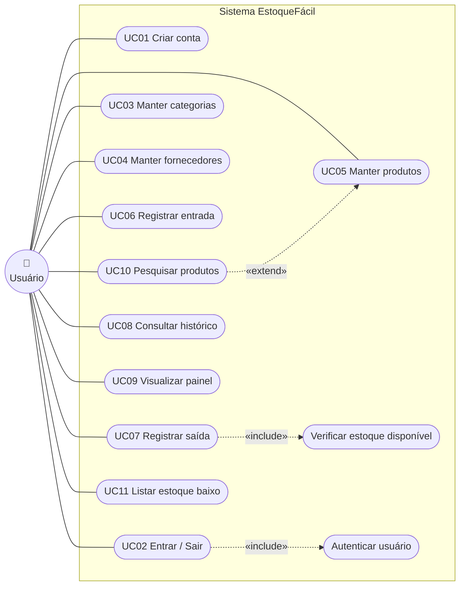
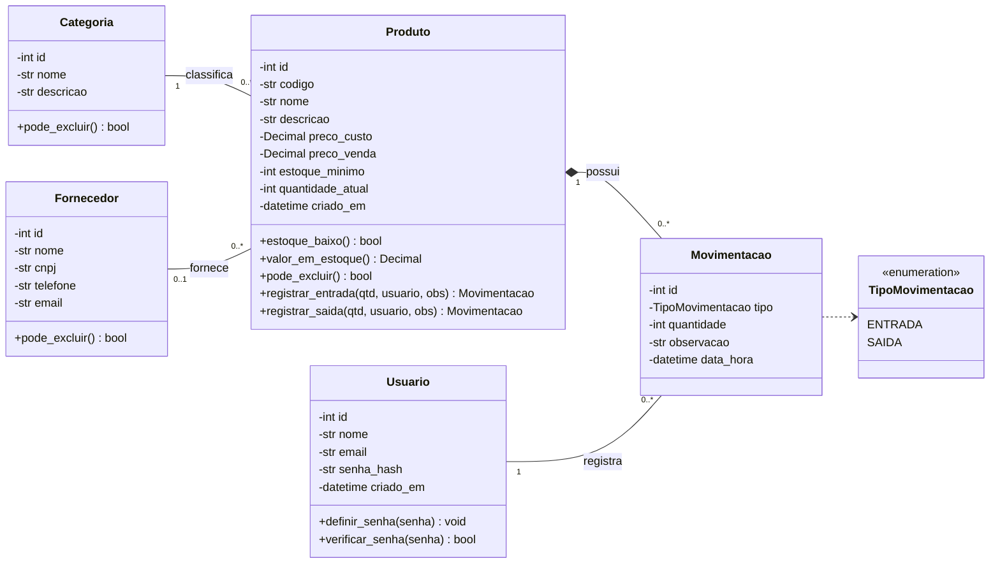
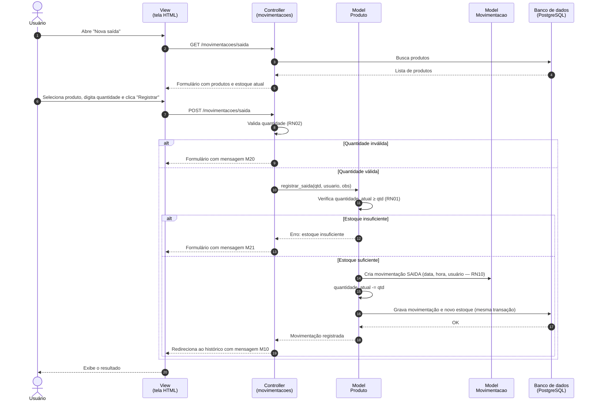
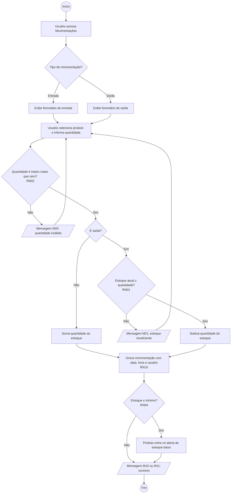

# 02: Modelagem UML — EstoqueFácil

Os diagramas foram escritos em [Mermaid](https://mermaid.js.org/), um formato de texto que o GitHub
desenha automaticamente. Assim os diagramas ficam versionados junto com o código.

Referência dos requisitos (RF) e regras (RN): [01-escopo-e-requisitos.md](01-escopo-e-requisitos.md).

---

## 1. Diagrama de casos de uso

> Todos os casos de uso, exceto UC01 e UC02, exigem que o usuário esteja autenticado (RN09).

### Descrição dos casos de uso

| Caso de uso | Requisito | Descrição resumida |
|---|---|---|
| UC01 Criar conta | RF01 | Usuário informa nome, e-mail e senha. O sistema valida o e-mail único e a senha com no mínimo 6 caracteres (RN08). |
| UC02 Entrar / Sair | RF02 | Usuário informa e-mail e senha para acessar. Ao sair, a sessão é encerrada. |
| UC03 Manter categorias | RF03 | Incluir, listar, editar e excluir. Exclusão bloqueada se houver produtos vinculados (RN06). |
| UC04 Manter fornecedores | RF04 | Incluir, listar, editar e excluir. Exclusão bloqueada se houver produtos vinculados (RN06). |
| UC05 Manter produtos | RF05 | Incluir, listar, editar e excluir. Código único (RN05); estoque inicial zero (RN03); exclusão bloqueada se houver movimentações (RN07). |
| UC06 Registrar entrada | RF06 | Usuário escolhe o produto e a quantidade. O estoque aumenta (RN02, RN10). |
| UC07 Registrar saída | RF07 | Usuário escolhe o produto e a quantidade. O sistema verifica o estoque disponível e bloqueia se for insuficiente (RN01). |
| UC08 Consultar histórico | RF08 | Lista de movimentações com filtros por produto, tipo e período. Somente leitura (RN11). |
| UC09 Visualizar painel | RF09 | Total de produtos, valor do estoque, produtos com estoque baixo e últimas movimentações (RN04). |
| UC10 Pesquisar produtos | RF10 | Busca por nome ou código e filtro por categoria na lista de produtos. |
| UC11 Listar estoque baixo | RF11 | Relatório dos produtos que precisam de reposição (RN04). |

### Detalhamento do caso de uso principal: UC07 Registrar saída

| Item | Descrição |
|---|---|
| **Ator** | Usuário |
| **Pré-condição** | Usuário autenticado; existe ao menos um produto cadastrado |
| **Fluxo principal** | 1. Usuário acessa "Movimentações → Nova saída". 2. Sistema exibe o formulário com a lista de produtos e o estoque atual de cada um. 3. Usuário seleciona o produto, informa a quantidade e, opcionalmente, uma observação. 4. Usuário clica em "Registrar". 5. Sistema valida a quantidade (RN02). 6. Sistema verifica o estoque disponível (RN01). 7. Sistema grava a movimentação com data, hora e usuário (RN10) e diminui o estoque. 8. Sistema exibe a mensagem M10 e volta ao histórico. |
| **Fluxo alternativo A1** (passo 5) | Quantidade vazia, zero, negativa ou não inteira: o sistema exibe a mensagem M20 e mantém os dados digitados. |
| **Fluxo alternativo A2** (passo 6) | Quantidade maior que o estoque: o sistema exibe a mensagem M21 informando a quantidade disponível e não grava nada. |
| **Pós-condição** | Movimentação registrada e estoque do produto atualizado. Se o estoque ficar menor ou igual ao mínimo, o produto passa a aparecer no alerta do painel (RN04). |

---

## 2. Diagrama de classes

### Explicação das classes

| Classe | Responsabilidade | Métodos importantes |
|---|---|---|
| **Usuario** | Quem acessa o sistema | `definir_senha` grava a senha criptografada (RNF04); `verificar_senha` confere a senha no login |
| **Categoria** | Agrupa produtos (ex.: Bebidas, Limpeza) | `pode_excluir` retorna falso se houver produtos (RN06) |
| **Fornecedor** | Empresa que fornece produtos | `pode_excluir` retorna falso se houver produtos (RN06) |
| **Produto** | Item controlado no estoque. É o centro do sistema | `estoque_baixo` aplica a RN04; `registrar_saida` aplica a RN01 e a RN02; `pode_excluir` aplica a RN07 |
| **Movimentacao** | Registro imutável de entrada ou saída (RN11) | Não tem métodos de alteração: só é criada |
| **TipoMovimentacao** | Enumeração com os dois tipos possíveis | — |

**Relacionamentos:**
- Toda categoria pode ter vários produtos; todo produto pertence a **uma** categoria.
- Um produto pode ter **um** fornecedor ou nenhum (fornecedor opcional).
- Movimentação é uma **composição** de Produto: não existe movimentação sem produto.
- Cada movimentação registra o usuário que a fez (RN10).

---

## 3. Diagrama de sequência: Registrar saída (UC07)

Mostra como as camadas do padrão **MVC** conversam durante a funcionalidade principal.

> A movimentação e o novo estoque são gravados na **mesma transação**: ou as duas gravações
> acontecem, ou nenhuma acontece. Isso impede que o estoque fique diferente do histórico.

---

## 4. Diagrama de atividades: Registrar movimentação (UC06 e UC07)

---

## 5. Rastreabilidade: requisitos × artefatos

| Requisito | Caso de uso | Classes envolvidas | Diagrama de apoio |
|---|---|---|---|
| RF01, RF02 | UC01, UC02 | Usuario | Casos de uso |
| RF03 | UC03 | Categoria | Classes |
| RF04 | UC04 | Fornecedor | Classes |
| RF05 | UC05 | Produto, Categoria, Fornecedor | Classes |
| RF06 | UC06 | Produto, Movimentacao, Usuario | Atividades |
| RF07 | UC07 | Produto, Movimentacao, Usuario | Sequência, Atividades |
| RF08 | UC08 | Movimentacao | Classes |
| RF09 | UC09 | Produto, Movimentacao | Classes |
| RF10 | UC10 | Produto, Categoria | Casos de uso |
| RF11 | UC11 | Produto | Classes |
