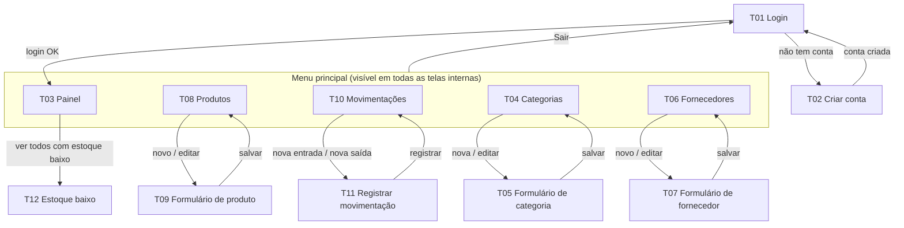
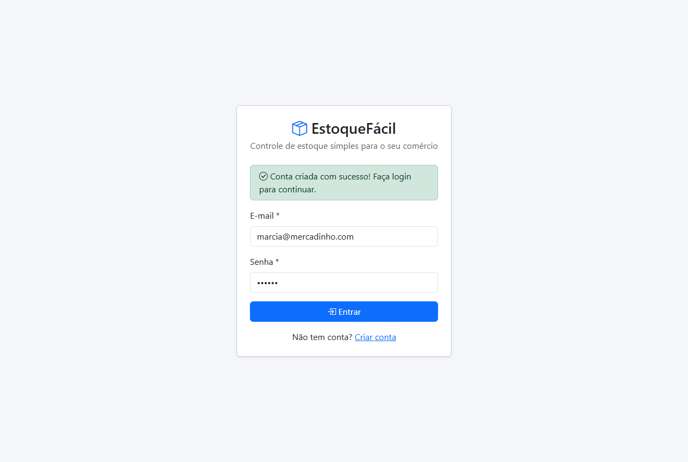
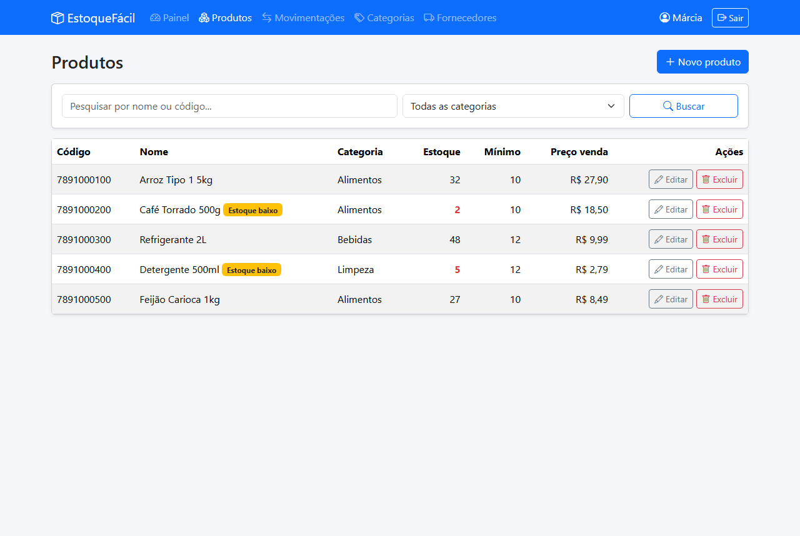
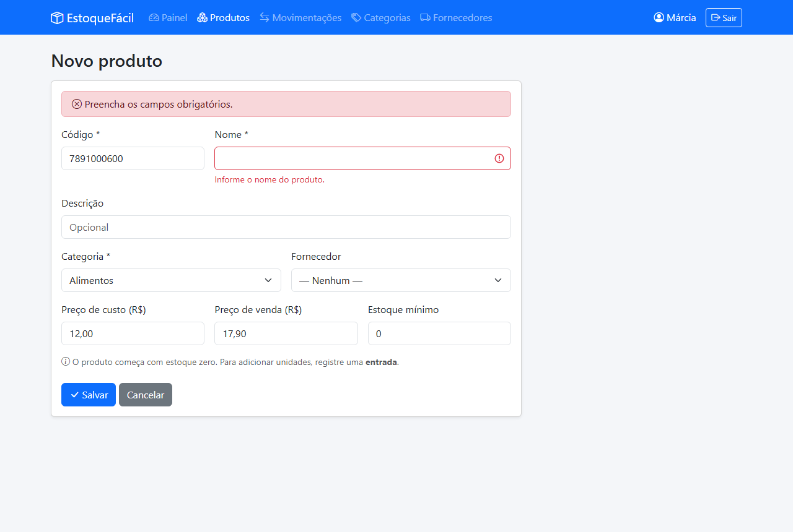
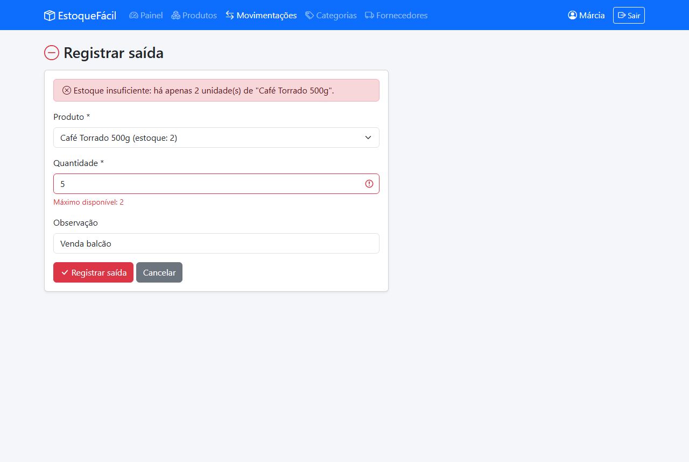
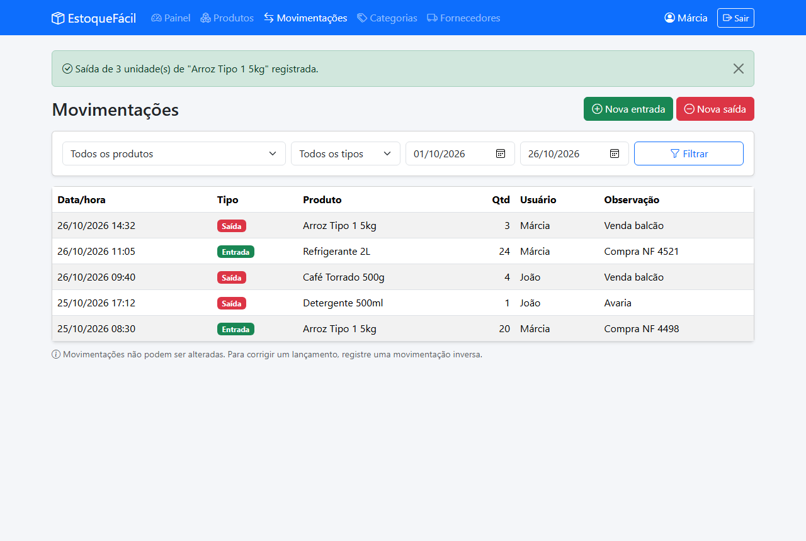

# 03: Interface Humano-Computador (IHC) e Protótipo — EstoqueFácil

## 1. Quem usa o sistema (persona)

> **Dona Márcia, 52 anos, dona de um mercadinho de bairro.**
> Usa o celular todos os dias (WhatsApp, banco), mas tem pouca familiaridade com computador.
> Hoje anota a mercadoria em um caderno e frequentemente percebe que um produto acabou só
> quando o cliente pede. Quer saber rapidamente **o que precisa comprar** e não tem tempo para
> aprender um sistema complicado.

**Consequências para a interface:**
- Poucas telas, sempre com o **mesmo menu** e os **mesmos botões** no mesmo lugar;
- Textos em português simples, sem termos técnicos;
- O que precisa de atenção (estoque baixo) aparece **logo na primeira tela**, em destaque;
- Funciona bem no celular.

---

## 2. Mapa de navegação

## 3. Lista de telas

| Tela | Nome | Elementos principais | Requisitos |
|---|---|---|---|
| T01 | Login | Campos e-mail e senha; botão "Entrar"; link "Criar conta" | RF02 |
| T02 | Criar conta | Nome, e-mail, senha, confirmar senha; botão "Criar conta" | RF01 |
| T03 | Painel | 4 cartões (total de produtos, valor do estoque, itens em estoque baixo, movimentações hoje); tabela "Precisa repor"; tabela "Últimas movimentações"; atalhos "Nova entrada" e "Nova saída" | RF09 |
| T04 | Categorias | Tabela (nome, descrição, nº de produtos); botões editar/excluir; botão "Nova categoria" | RF03 |
| T05 | Formulário de categoria | Nome*, descrição; botões "Salvar" e "Cancelar" | RF03 |
| T06 | Fornecedores | Tabela (nome, CNPJ, telefone, e-mail); botões editar/excluir; botão "Novo fornecedor" | RF04 |
| T07 | Formulário de fornecedor | Nome*, CNPJ, telefone, e-mail; botões "Salvar" e "Cancelar" | RF04 |
| T08 | Produtos | Campo de busca; filtro de categoria; tabela (código, nome, categoria, estoque, mínimo, preço); selo "Estoque baixo"; botões editar/excluir; botão "Novo produto" | RF05, RF10 |
| T09 | Formulário de produto | Código*, nome*, descrição, categoria* (lista), fornecedor (lista), preço de custo, preço de venda, estoque mínimo. **Sem campo de quantidade** (RN03) | RF05 |
| T10 | Movimentações (histórico) | Filtros: produto, tipo, data inicial e final; tabela (data/hora, tipo, produto, quantidade, usuário, observação); botões "Nova entrada" e "Nova saída" | RF08 |
| T11 | Registrar movimentação | Tipo (entrada/saída); produto (lista mostrando o estoque atual); quantidade*; observação; botão "Registrar" | RF06, RF07 |
| T12 | Estoque baixo | Tabela dos produtos com estoque ≤ mínimo, com a quantidade sugerida para repor | RF11 |
| T13 | Páginas de erro | "Página não encontrada" (404) e "Erro inesperado" (500), com botão "Voltar ao painel" | RNF01 |

\* campo obrigatório

---

## 4. Padrões de interface

| Elemento | Padrão adotado |
|---|---|
| **Estrutura** | Barra de menu fixa no topo com o nome do sistema, os itens do menu e o nome do usuário + "Sair". No celular, o menu vira um botão ☰ |
| **Cores** | Azul = ações principais (salvar, registrar) · Verde = entrada e mensagens de sucesso · Vermelho = saída, exclusão e erros · Amarelo = alerta de estoque baixo · Cinza = cancelar/voltar |
| **Botões** | Ação principal sempre à esquerda em azul; "Cancelar" ao lado, em cinza. Ícone + texto (nunca só ícone) |
| **Formulários** | Rótulo acima do campo; obrigatórios marcados com `*`; erro exibido **embaixo do próprio campo**, em vermelho; os dados digitados são mantidos após um erro |
| **Tabelas** | Cabeçalho fixo; linhas alternadas; ações (editar/excluir) na última coluna; mensagem "Nenhum registro encontrado" quando vazia |
| **Mensagens** | Faixa colorida no topo da página, que pode ser fechada (ver catálogo abaixo) |
| **Tipografia** | Fonte padrão do sistema; títulos de página em tamanho grande; números do painel em destaque |
| **Responsividade** | Layout em grade (Bootstrap): no celular, cartões e colunas se empilham; tabelas rolam na horizontal |

### Princípios de IHC aplicados (material teórico)

| Princípio | Como foi aplicado |
|---|---|
| **Clareza** | Rótulos em português simples ("Nova saída" em vez de "Lançamento de débito") |
| **Consistência** | Todas as listas e formulários seguem o mesmo layout e os mesmos botões |
| **Simplicidade** | Apenas 5 itens no menu; campos opcionais claramente indicados |
| **Controle do usuário** | Nada acontece sem um clique do usuário; sempre há "Cancelar" |
| **Ação direta** | Após salvar, o usuário vê imediatamente o item na lista e o estoque atualizado |
| **Recuperação de erros** | Confirmação antes de excluir; lançamento errado é corrigido por movimentação inversa (RN11), e a tela explica como |
| **Feedback** | Toda ação mostra mensagem de sucesso ou erro (catálogo abaixo) |
| **Estética** | Visual limpo, com cores usadas apenas para comunicar significado |
| **Padrões (defaults)** | Data de hoje pré-preenchida nos filtros; estoque mínimo já vem com 0; a lista de produtos da saída mostra o estoque disponível |

---

## 5. Catálogo de mensagens

`{…}` = valor preenchido pelo sistema.

### Sucesso (faixa verde)
| Código | Mensagem | Onde aparece |
|---|---|---|
| M01 | Conta criada com sucesso! Faça login para continuar. | T01, após criar conta |
| M02 | Bem-vindo(a), {nome}! | T03, após login |
| M03 | Você saiu do sistema. | T01, após logout |
| M04 | {Item} cadastrado(a) com sucesso. | Listas, após incluir |
| M05 | {Item} atualizado(a) com sucesso. | Listas, após editar |
| M06 | {Item} excluído(a) com sucesso. | Listas, após excluir |
| M10 | Saída de {quantidade} unidade(s) de "{produto}" registrada. | T10 |
| M11 | Entrada de {quantidade} unidade(s) de "{produto}" registrada. | T10 |

### Erro (faixa ou texto vermelho)
| Código | Mensagem | Regra |
|---|---|---|
| M20 | Informe uma quantidade inteira maior que zero. | RN02 |
| M21 | Estoque insuficiente: há apenas {disponível} unidade(s) de "{produto}". | RN01 |
| M22 | E-mail ou senha incorretos. | RF02 |
| M23 | Este e-mail já está cadastrado. | RN08 |
| M24 | A senha deve ter no mínimo 6 caracteres. | RN08 |
| M25 | As senhas não conferem. | RF01 |
| M26 | Já existe um produto com o código "{código}". | RN05 |
| M27 | Não é possível excluir: existem {n} produto(s) vinculado(s). | RN06 |
| M28 | Não é possível excluir: este produto possui movimentações. Para corrigir o estoque, registre uma movimentação inversa. | RN07, RN11 |
| M29 | Preencha os campos obrigatórios. | Formulários |
| M30 | O valor não pode ser negativo. | RN12 |
| M31 | CNPJ inválido: informe os 14 números. | Fornecedor |
| M32 | Já existe uma categoria com esse nome. | Categoria |
| M33 | Faça login para acessar esta página. | RN09 |
| M34 | Página não encontrada. | T13 (404) |
| M35 | Ocorreu um erro inesperado. Tente novamente em instantes. | T13 (500) |

### Confirmação (janela de diálogo)
| Código | Mensagem |
|---|---|
| M40 | Tem certeza que deseja excluir "{nome}"? Esta ação não pode ser desfeita. |

### Aviso (faixa amarela)
| Código | Mensagem | Onde aparece |
|---|---|---|
| M50 | {n} produto(s) com estoque baixo. Ver lista. | T03 |
| M51 | Nenhum registro encontrado. | Listas vazias ou busca sem resultado |
| M52 | Atenção: após esta saída, "{produto}" ficará com estoque baixo. | T10, após uma saída |

---

## 6. Protótipo

O protótipo navegável está em [`prototipo/index.html`](prototipo/index.html). Para ver as telas,
abra o arquivo no navegador (duplo clique) e use os botões do topo.

Telas prototipadas: **Login (T01)**, **Painel (T03)**, **Produtos (T08)**, **Formulário de produto (T09)**,
**Registrar saída com erro (T11 + M21)** e **Histórico de movimentações (T10)**.

### Capturas de tela

<!-- Prints gerados a partir do protótipo (salvos em prototipo/prints/) -->
| T01 Login | T03 Painel |
|---|---|
|  |  |

| T08 Produtos | T09 Formulário de produto |
|---|---|
|  |  |

| T11 Registrar saída (erro M21) | T10 Histórico |
|---|---|
|  |  |
