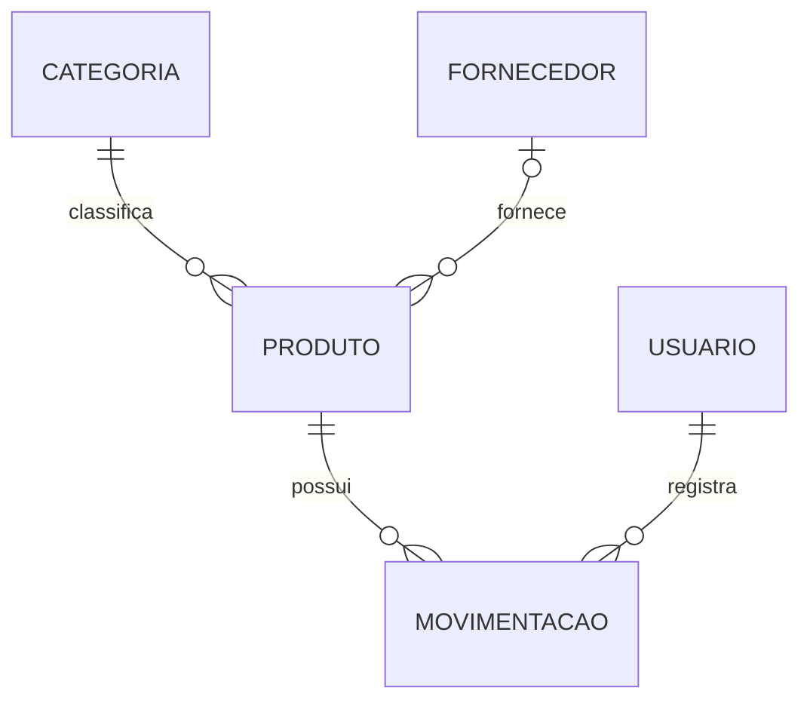
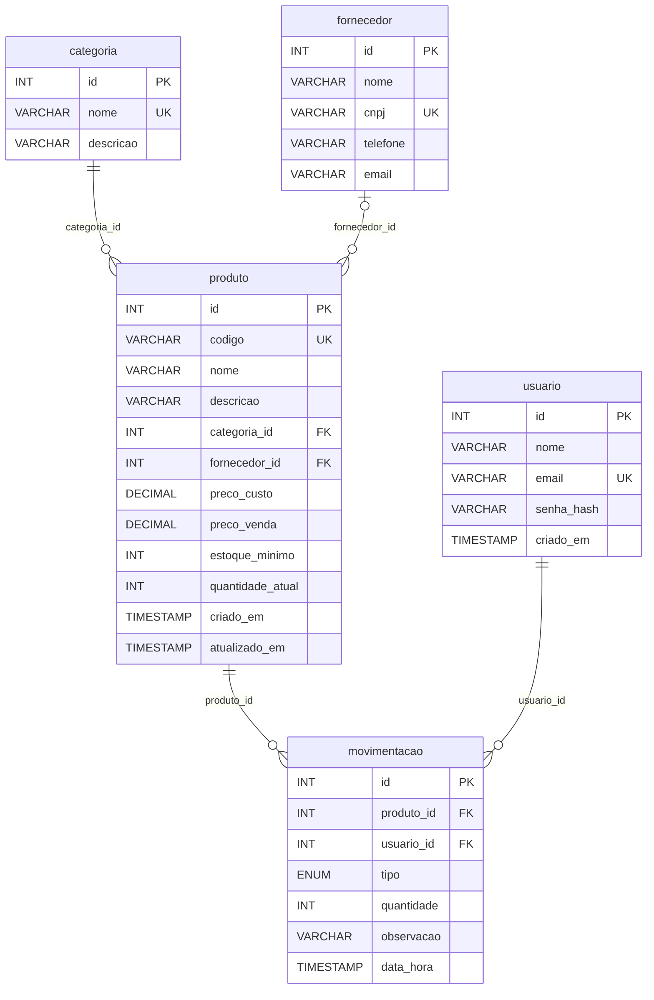

# 04: Projeto de Banco de Dados — EstoqueFácil

O banco foi projetado em três níveis, a partir do [diagrama de classes](02-modelagem-uml.md#2-diagrama-de-classes):

1. **Conceitual:** quais "coisas" o sistema guarda e como se relacionam;
2. **Lógico:** tabelas, colunas, chaves e normalização;
3. **Físico:** os comandos SQL para o SGBD escolhido, em [`database/schema.sql`](../../database/schema.sql).

**SGBD:** PostgreSQL 16+, hospedado no [Neon](https://neon.tech) (plano gratuito). É um SGBD popular, gratuito,
de código aberto, de fácil manutenção e amplamente usado no mercado.

---

## 1. Modelo conceitual

| Relacionamento | Cardinalidade | Leitura |
|---|---|---|
| Categoria — Produto | 1 : N | Uma categoria classifica zero ou muitos produtos; cada produto tem exatamente uma categoria |
| Fornecedor — Produto | 0..1 : N | Um fornecedor fornece zero ou muitos produtos; um produto tem um fornecedor ou nenhum |
| Produto — Movimentação | 1 : N | Um produto possui zero ou muitas movimentações; cada movimentação é de exatamente um produto |
| Usuário — Movimentação | 1 : N | Um usuário registra zero ou muitas movimentações; cada movimentação tem exatamente um responsável |

---

## 2. Modelo lógico

**Legenda:** PK = chave primária · FK = chave estrangeira · UK = valor único

### 2.1 Mapeamento classe → tabela

| Classe (UML) | Tabela | Observação |
|---|---|---|
| Usuario | `usuario` | A senha nunca é gravada; grava-se apenas o hash (RNF04) |
| Categoria | `categoria` | — |
| Fornecedor | `fornecedor` | — |
| Produto | `produto` | Associações com Categoria e Fornecedor viram as FKs `categoria_id` e `fornecedor_id` |
| Movimentacao | `movimentacao` | Associações com Produto e Usuario viram FKs; a enumeração `TipoMovimentacao` vira a coluna `tipo` (ENUM) |

### 2.2 Normalização

| Forma normal | Exigência | Como o modelo atende |
|---|---|---|
| **1FN** | Todos os campos são atômicos (um único valor), sem grupos repetidos | Cada coluna guarda um só valor. Ex.: o telefone do fornecedor é um único campo; não há listas de produtos dentro de categoria |
| **2FN** | Estar na 1FN e todo campo não chave depender da chave **inteira** | Todas as tabelas têm chave primária simples (`id`), portanto não há dependência parcial |
| **3FN** | Estar na 2FN e nenhum campo não chave depender de outro campo não chave | Dados da categoria e do fornecedor não são repetidos no produto: ficam nas próprias tabelas e são referenciados por FK. O nome do produto não é copiado na movimentação |

**Redundância controlada (decisão de projeto):** a coluna `produto.quantidade_atual` poderia ser
calculada somando as entradas e subtraindo as saídas da tabela `movimentacao`. Ela foi mantida
por dois motivos:

1. **Desempenho:** o painel e as listas mostram o estoque de todos os produtos o tempo todo, e
   recalcular a soma de todo o histórico a cada tela seria lento;
2. **Regra RN01:** verificar se há estoque suficiente fica simples e rápido.

Para garantir que o valor nunca fique diferente do histórico: (a) a quantidade **não pode ser
editada** pelo usuário (RN03); (b) ela só é alterada pelo sistema **na mesma transação** que grava
a movimentação; (c) o banco impede valores negativos (`CHECK (quantidade_atual >= 0)`).

---

## 3. Modelo físico

O script completo está em [`database/schema.sql`](../../database/schema.sql). Restrições
implementadas diretamente no banco:

| Regra | Implementação no PostgreSQL |
|---|---|
| RN05: código do produto único | `UNIQUE (codigo)` |
| RN06: não excluir categoria/fornecedor com produtos | `FOREIGN KEY ... ON DELETE RESTRICT` |
| RN07: não excluir produto com movimentações | `FOREIGN KEY ... ON DELETE RESTRICT` |
| RN08: e-mail único | `UNIQUE (email)` |
| RN02: quantidade maior que zero | `CHECK (quantidade > 0)` |
| RN03: estoque nunca negativo | `CHECK (quantidade_atual >= 0)` |
| RN12: preços não negativos | `CHECK (preco_custo >= 0)` e `CHECK (preco_venda >= 0)` |
| RN10: data e hora automáticas | `DEFAULT CURRENT_TIMESTAMP` |

**Índices criados para as consultas mais frequentes:**

| Índice | Tabela | Consulta atendida |
|---|---|---|
| `idx_produto_nome` | produto | Pesquisa de produtos por nome (RF10) |
| `idx_mov_produto_data` | movimentacao | Histórico filtrado por produto e período (RF08) |
| `idx_mov_data` | movimentacao | Últimas movimentações no painel (RF09) |

---

## 4. Dicionário de dados

**Legenda:** PK = chave primária · FK = chave estrangeira · UK = único · NN = obrigatório (NOT NULL) · AI = auto incremento

### Tabela `usuario`: pessoas que acessam o sistema

| Coluna | Tipo | Restrições | Domínio / formato | Descrição |
|---|---|---|---|---|
| id | SERIAL | PK, AI, NN | 1, 2, 3… | Identificador do usuário |
| nome | VARCHAR(100) | NN | 2 a 100 caracteres | Nome completo |
| email | VARCHAR(120) | UK, NN | E-mail válido (ex.: `ana@email.com`) | Usado no login |
| senha_hash | VARCHAR(255) | NN | Hash gerado pelo sistema | Senha criptografada. A senha original tem no mínimo 6 caracteres (RN08) |
| criado_em | TIMESTAMP | NN, padrão = agora | Data e hora | Quando a conta foi criada |

### Tabela `categoria`: agrupamento de produtos

| Coluna | Tipo | Restrições | Domínio / formato | Descrição |
|---|---|---|---|---|
| id | SERIAL | PK, AI, NN | 1, 2, 3… | Identificador da categoria |
| nome | VARCHAR(60) | UK, NN | 2 a 60 caracteres | Ex.: "Bebidas", "Limpeza" |
| descricao | VARCHAR(255) | — | Até 255 caracteres | Descrição opcional |

### Tabela `fornecedor`: empresas que fornecem produtos

| Coluna | Tipo | Restrições | Domínio / formato | Descrição |
|---|---|---|---|---|
| id | SERIAL | PK, AI, NN | 1, 2, 3… | Identificador do fornecedor |
| nome | VARCHAR(100) | NN | 2 a 100 caracteres | Razão social ou nome fantasia |
| cnpj | VARCHAR(14) | UK, CHECK 14 dígitos | Exatamente 14 dígitos, sem pontuação | CNPJ (opcional) |
| telefone | VARCHAR(20) | — | Ex.: `(41) 99999-0000` | Telefone de contato (opcional) |
| email | VARCHAR(120) | — | E-mail válido | E-mail de contato (opcional) |

### Tabela `produto`: itens controlados no estoque

| Coluna | Tipo | Restrições | Domínio / formato | Descrição |
|---|---|---|---|---|
| id | SERIAL | PK, AI, NN | 1, 2, 3… | Identificador do produto |
| codigo | VARCHAR(30) | UK, NN | Letras, números e hífen | Código interno ou de barras (RN05) |
| nome | VARCHAR(100) | NN | 2 a 100 caracteres | Nome do produto |
| descricao | VARCHAR(255) | — | Até 255 caracteres | Descrição opcional |
| categoria_id | INTEGER | FK → categoria.id, NN | Categoria existente | Categoria do produto |
| fornecedor_id | INTEGER | FK → fornecedor.id | Fornecedor existente ou vazio | Fornecedor principal (opcional) |
| preco_custo | DECIMAL(10,2) | NN, ≥ 0, padrão 0 | 0,00 a 99.999.999,99 | Preço pago ao fornecedor (RN12) |
| preco_venda | DECIMAL(10,2) | NN, ≥ 0, padrão 0 | 0,00 a 99.999.999,99 | Preço de venda ao cliente (RN12) |
| estoque_minimo | INTEGER | NN, ≥ 0, padrão 0 | 0 ou mais | Abaixo ou igual a este valor = estoque baixo (RN04) |
| quantidade_atual | INTEGER | NN, ≥ 0, padrão 0 | 0 ou mais | Estoque atual. Alterado **somente** por movimentações (RN03) |
| criado_em | TIMESTAMP | NN, padrão = agora | Data e hora | Data de cadastro |
| atualizado_em | TIMESTAMP | NN, atualização automática | Data e hora | Data da última alteração |

### Tabela `movimentacao`: entradas e saídas de mercadoria

| Coluna | Tipo | Restrições | Domínio / formato | Descrição |
|---|---|---|---|---|
| id | SERIAL | PK, AI, NN | 1, 2, 3… | Identificador da movimentação |
| produto_id | INTEGER | FK → produto.id, NN | Produto existente | Produto movimentado |
| usuario_id | INTEGER | FK → usuario.id, NN | Usuário existente | Quem registrou (RN10) |
| tipo | ENUM `tipo_movimentacao` | NN | `ENTRADA` ou `SAIDA` | Tipo da movimentação |
| quantidade | INTEGER | NN, > 0 | Inteiro maior que zero | Quantidade movimentada (RN02) |
| observacao | VARCHAR(255) | — | Até 255 caracteres | Motivo (ex.: "compra NF 123", "avaria") |
| data_hora | TIMESTAMP | NN, padrão = agora | Data e hora | Momento do registro (RN10) |
