# Manual de Uso — EstoqueFácil

O EstoqueFácil é um sistema web para controlar o estoque de pequenos comércios. Ele funciona no navegador do computador
ou do celular e não precisa de instalação.

| Item | Informação |
|---|---|
| Endereço | https://estoquefacil-f1t6.onrender.com |
| Usuário de demonstração | `demo@estoquefacil.com` |
| Senha de demonstração | `demo123` |

> A hospedagem gratuita desliga o site quando ele fica 15 minutos sem acesso. Por isso, a primeira abertura pode levar
> cerca de 1 minuto. Depois disso, o sistema responde normalmente.

## Ordem recomendada para começar

1. Cadastre as **categorias** dos produtos.
2. Cadastre os **fornecedores** (opcional).
3. Cadastre os **produtos**. Todo produto começa com estoque zero.
4. Registre uma **entrada** para cada produto, informando a quantidade que você tem.
5. A partir daí, registre as **entradas e saídas** do dia a dia e acompanhe o **painel**.

Campos marcados com `*` são obrigatórios.

---

## 1. Entrar e criar conta

Informe e-mail e senha e clique em **Entrar**. Para sair, clique em **Sair**, no canto superior direito.

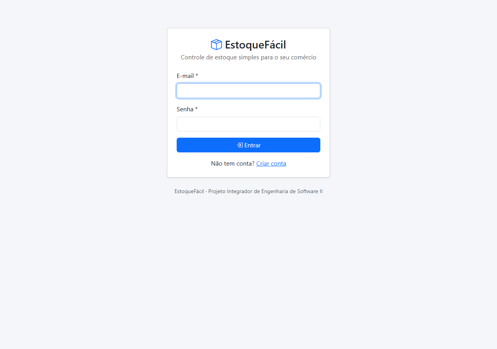

Se ainda não tem conta, clique em **Criar conta**. O e-mail não pode estar em uso e a senha precisa ter no mínimo
6 caracteres.

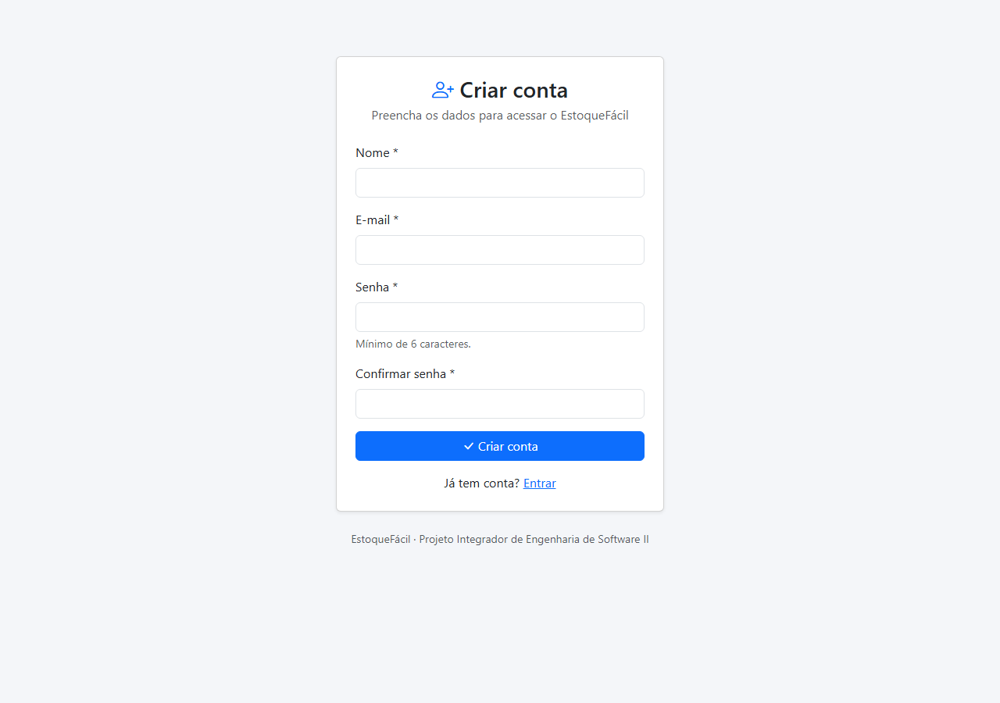

## 2. Painel

É a primeira tela depois do login. Ela mostra:

- total de produtos, valor do estoque, produtos com estoque baixo e movimentações do dia;
- **Precisa repor:** produtos com estoque igual ou abaixo do mínimo, com a **sugestão de compra**;
- **Últimas movimentações** registradas;
- botões de atalho **Nova entrada** e **Nova saída**.

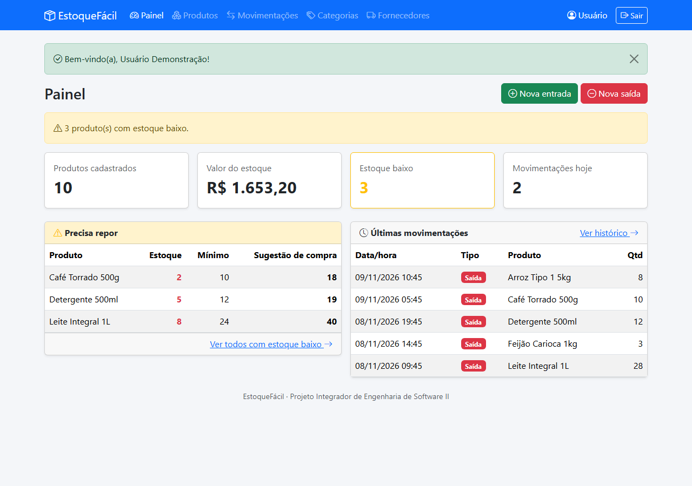

## 3. Produtos

No menu **Produtos** você pesquisa, inclui, edita e exclui produtos.

- A **pesquisa** aceita nome ou código e não diferencia acentos nem maiúsculas: `cafe` encontra "Café".
- Use os filtros de **categoria** e **Estoque baixo** e clique em **Buscar**.
- Produtos com estoque igual ou abaixo do mínimo aparecem com a etiqueta **Estoque baixo**.

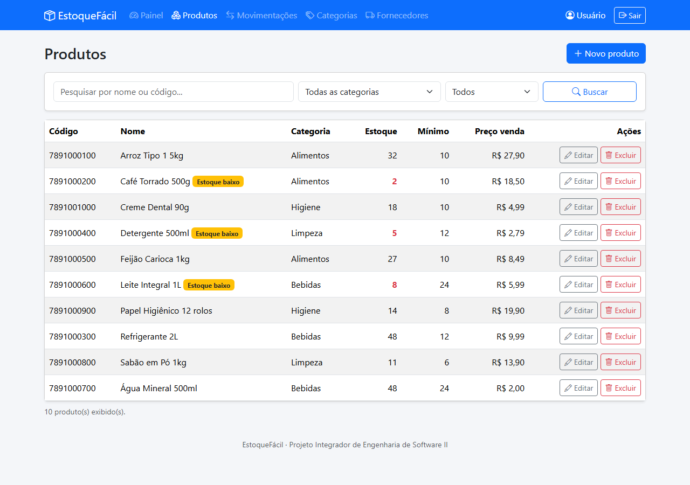

### Cadastrar ou editar um produto

Clique em **Novo produto** ou em **Editar**. Os preços podem ser digitados com vírgula, como `12,50`. O código precisa ser
único. A quantidade em estoque não aparece no cadastro, porque ela só muda por entradas e saídas.

**Preço de venda menor que o custo:** o sistema avisa e só salva depois que você marca a confirmação
"Estou ciente e quero vender este produto abaixo do custo".

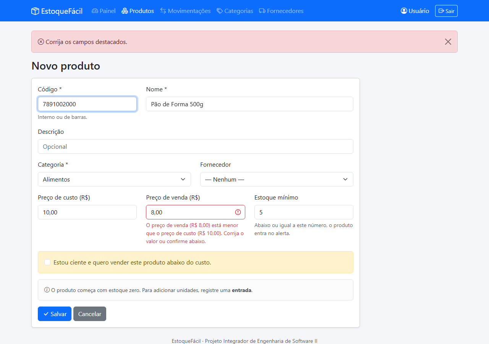

### Saber o que comprar

Selecione o filtro **Estoque baixo** e clique em **Buscar**. A coluna **Sugestão de compra** mostra quantas unidades comprar
para o estoque chegar ao dobro do mínimo. Exemplo: com mínimo 10 e estoque 2, a sugestão é 18 (10 × 2 − 2).

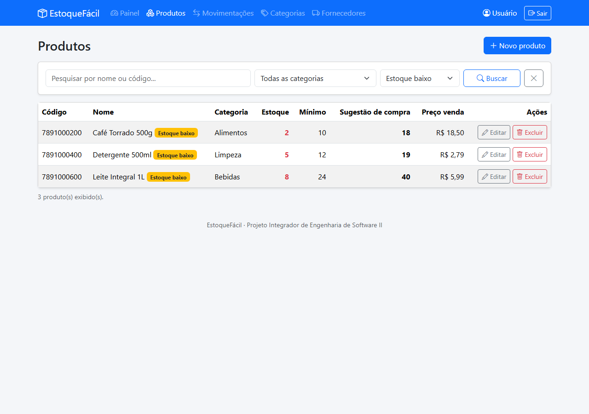

### Excluir um produto

Clique em **Excluir** e confirme. Produtos que já tiveram movimentações não podem ser excluídos, para preservar o histórico.

## 4. Categorias

No menu **Categorias** você organiza os produtos em grupos, como Bebidas e Limpeza. O número da coluna **Produtos** abre a
lista de produtos daquela categoria. Uma categoria com produtos vinculados não pode ser excluída.

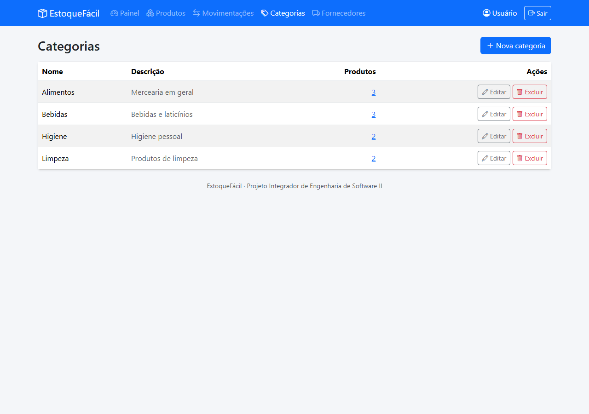

## 5. Fornecedores

No menu **Fornecedores** você registra quem fornece os produtos. Apenas o nome é obrigatório. O CNPJ, quando informado,
deve ter 14 números e pode ser digitado com ou sem pontuação. Um fornecedor com produtos vinculados não pode ser excluído.

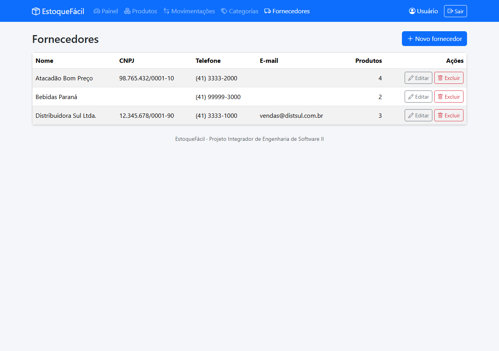

## 6. Entradas e saídas

Clique em **Nova entrada** quando a mercadoria chegar ou em **Nova saída** quando ela sair. Escolha o produto, informe a
quantidade (número inteiro maior que zero) e, se quiser, uma observação. A data, a hora e o usuário são registrados
automaticamente.

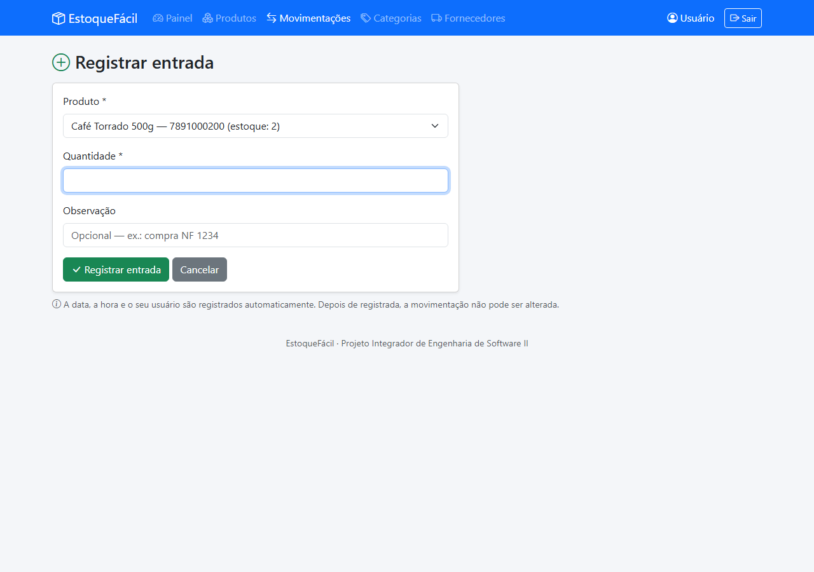

Se a saída for maior que o estoque disponível, o sistema bloqueia a operação e informa quanto existe. Se a saída deixar o
produto com estoque baixo, aparece um aviso amarelo.

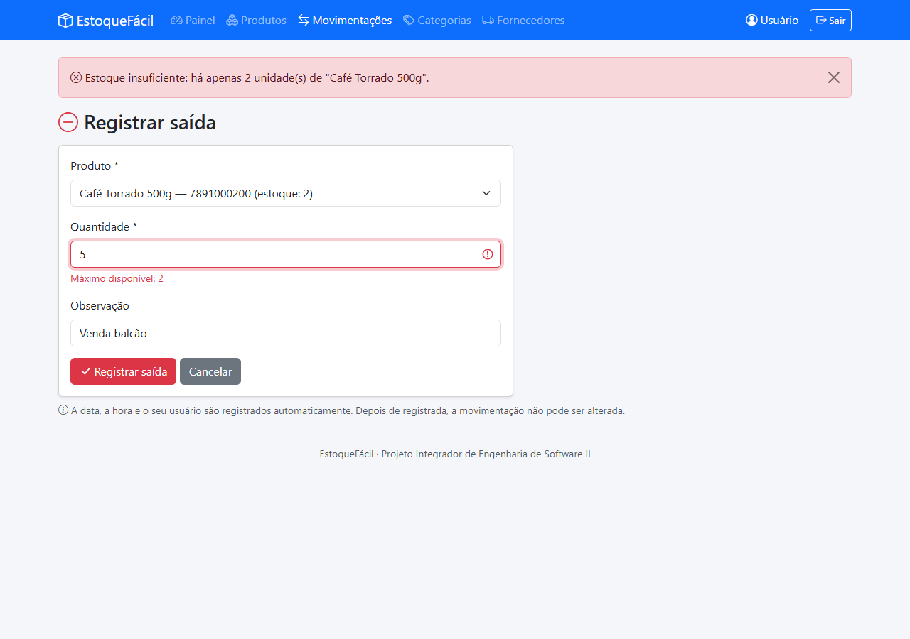

## 7. Histórico de movimentações

O menu **Movimentações** lista as entradas e saídas, por padrão dos últimos 30 dias. Filtre por produto, tipo e período e
clique em **Filtrar**.

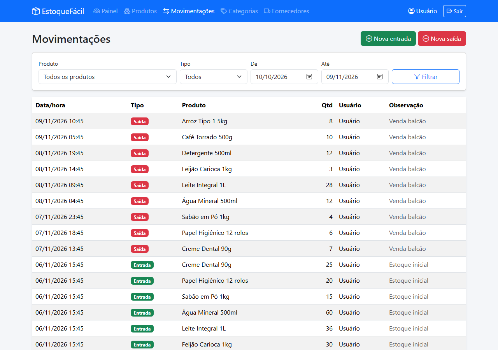

**Lancei algo errado, e agora?** Movimentações não podem ser alteradas nem excluídas. Corrija registrando a operação
inversa: uma entrada lançada a mais é corrigida com uma saída da mesma quantidade, e vice-versa.

---

## Perguntas frequentes

| Situação | O que fazer |
|---|---|
| O site demora para abrir | Aguarde cerca de 1 minuto: ele estava desligado por falta de acesso |
| "Sua sessão expirou" | Tente de novo. A página pode ter ficado aberta por muito tempo |
| "Estoque insuficiente" | A saída é maior que o estoque. Confira a quantidade ou registre uma entrada antes |
| Não consigo excluir uma categoria ou fornecedor | Há produtos vinculados. Altere esses produtos antes |
| Não consigo excluir um produto | Ele já teve movimentações e precisa permanecer no histórico |
| Esqueci a senha | Esta versão não tem recuperação de senha. Crie outra conta com outro e-mail |
